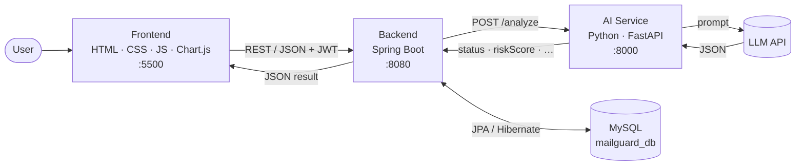
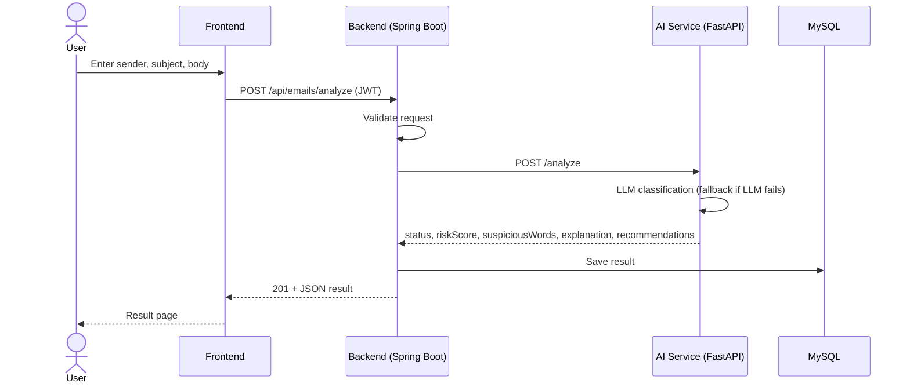

<div align="center">

# 🛡️ MailGuard AI

### AI-Powered Trash Email Detection System

**Paste an email. Get an instant verdict — Safe, Spam, Promotional or Phishing — with a risk score and a plain-English explanation.**


</div>

---

## 📑 Table of Contents
1. [About the Project](#-about-the-project)
2. [Key Features](#-key-features)
3. [Architecture](#-architecture)
4. [Tech Stack](#-tech-stack)
5. [Team](#-team)
6. [Repository Structure](#-repository-structure)
7. [Quick Start (Run the Whole Project)](#-quick-start-run-the-whole-project)
8. [Module Guides](#-module-guides)
   - [Frontend](#1-frontend)
   - [Backend](#2-backend)
   - [AI Service](#3-ai-service)
9. [API Reference](#-api-reference)
10. [AI Service Contract](#-ai-service-contract)
11. [Database Schema](#-database-schema)
12. [Demo Emails](#-demo-emails)
13. [Testing](#-testing)
14. [Git Workflow](#-git-workflow)
15. [Troubleshooting](#-troubleshooting)
16. [Known Limitations & Future Scope](#-known-limitations--future-scope)

---

## 📌 About the Project

Inboxes are full of junk, scams and fake "verify your account" messages. **MailGuard AI** is a web application where a user pastes an email (sender, subject, body) and an AI model classifies it into one of four categories:

| Category | Meaning |
|---|---|
| ✅ **SAFE** | Normal, trusted email (office, friends, bank alerts) |
| 🚫 **SPAM** | Unwanted / junk mail (lottery, fake offers, mass mails) |
| 📣 **PROMOTIONAL** | Marketing mails, offers and newsletters from genuine companies |
| 🎣 **PHISHING** | Fake emails that try to steal passwords, OTPs or bank details |

Every result includes a **risk score (0–100)**, the **suspicious words** found, a **2–3 sentence AI explanation** and **safety recommendations**. All scans are stored, so users can review them in **History** and see trends on the **Dashboard** and **Analytics** pages.

> **Final goal:** User enters an email → AI analyses it → Safe / Spam / Promotional / Phishing result is shown → result is saved in history.

---

## ✨ Key Features

- 🔐 **Authentication** – Register / Login with BCrypt-hashed passwords and JWT tokens
- 🔍 **Email Analyzer** – Submit sender, subject and body; loading animation while the AI works
- 🧠 **AI Classification** – LLM-based verdict with a rule-based **fallback** if the LLM fails
- 📊 **Risk Score** – 0–100, always consistent with the status (Low / Medium / High)
- 🧾 **Explainable results** – suspicious words, explanation and recommendations
- 🕘 **History** – search, filter by status, sort, view details and delete
- 📈 **Dashboard & Analytics** – totals, per-category counts, threat detection rate, weekly chart (Chart.js)
- 📱 **Responsive SaaS-style UI** – navy sidebar, modern cards, works on desktop, tablet and mobile
- ⚠️ **Robust errors** – consistent JSON errors and proper HTTP codes (200, 201, 400, 401, 404, 503, 500)

---

## 🏗 Architecture



### Request flow – Analyze an email



| Component | Default URL |
|---|---|
| Frontend (VS Code Live Server) | `http://127.0.0.1:5500` |
| Backend (Spring Boot) | `http://localhost:8081` |
| AI Service (FastAPI) | `http://localhost:8000` (Swagger docs at `/docs`) |
| MySQL | `localhost:3306` |

---

## 🛠 Tech Stack

| Layer | Technologies |
|---|---|
| **Frontend** | HTML5, CSS3, JavaScript (Fetch API), Chart.js |
| **Backend** | Java 17, Spring Boot 3, Spring Data JPA , Bean Validation, JWT, BCrypt, Lombok |
| **AI Service** | Python 3.10+, FastAPI, Uvicorn, Pydantic, python-dotenv, LLM API (Claude / OpenAI / Gemini) |
| **Database** | MySQL 8 |
| **Tools** | Git & GitHub, Postman, FastAPI Swagger, VS Code, IntelliJ IDEA |

---

## 👥 Team

| Member | Role | Owns | GitHub |
|---|---|---|---|
| **Member 1** – Samruddhi Pawar | Frontend Developer | `frontend/` – all pages, JavaScript, charts, API integration | [@username](https://github.com/samruddhipawar323) |
| **Member 2** – Vaishnav Salunke | Backend Developer | `backend/` – REST APIs, MySQL, auth, AI integration, Postman | [@username](https://github.com/vaishverse28) |
| **Member 3** – Shantanu Pawar | AI Developer | `ai-service/` – classifier, prompt, fallback, tests | [@username](https://github.com/pawarshantanu858-maker) |


---

## 📁 Repository Structure

All three parts live in **one repository** (monorepo). Each member works inside their own folder.

```
MailGuard-AI/
│
├── frontend/                          # 🎨 Samruddhi Pawar
│   ├── index.html
│   ├── pages/
│   │   ├── login.html
│   │   ├── register.html
│   │   ├── dashboard.html
│   │   ├── analyzer.html
│   │   ├── result.html
│   │   ├── history.html
│   │   ├── analytics.html
│   │   └── settings.html
│   ├── css/        (style.css, login.css, dashboard.css, responsive.css)
│   ├── js/         (main.js, auth.js, analyzer.js, dashboard.js, history.js, api.js)
│   └── assets/     (images/, icons/)
│
├── backend/                           # ⚙️ Vaishnav Salunke
│   ├── src/main/java/com/mailguard/
│   │   ├── controller/   AuthController · EmailController · DashboardController
│   │   ├── service/      AuthService · EmailService · AiClientService · DashboardService
│   │   ├── repository/   UserRepository · EmailAnalysisRepository
│   │   ├── model/        User · EmailAnalysis · EmailStatus
│   │   ├── dto/          request / response objects
│   │   ├── config/       CorsConfig · WebConfig · AppConfig
│   │   ├── security/     JwtUtil · AuthInterceptor
│   │   └── exception/    ApiException · GlobalExceptionHandler
│   ├── src/main/resources/application.properties
│   ├── database/schema.sql
│   ├── postman/MailGuard_AI.postman_collection.json
│   ├── pom.xml
│   └── README.md
│
├── ai-service/                        # 🧠 Shantanu Pawar
│   ├── app/
│   │   ├── main.py          FastAPI app + /analyze endpoint
│   │   ├── classifier.py    LLM call + response parsing
│   │   ├── prompts.py       system prompt + instructions
│   │   ├── fallback.py      rule-based keyword check
│   │   └── schemas.py       Pydantic request/response models
│   ├── tests/
│   │   ├── sample_emails.json
│   │   └── test_classifier.py
│   ├── .env.example
│   ├── requirements.txt
│   └── README.md
│
├── docs/
│   └── screenshots/                   # final demo screenshots
├── .gitignore
└── README.md                          # ← you are here
```

---

## 🚀 Quick Start (Run the Whole Project)

**Start in this order:** `MySQL → AI Service → Backend → Frontend`

### Prerequisites
| Tool | Version |
|---|---|
| Java JDK | 17+ |
| Maven | 3.8+ (or IntelliJ bundled) |
| MySQL | 8+ |
| Python | 3.10+ |
| VS Code + Live Server extension | latest |
| Postman | optional, for API testing |

### Step 1 – Clone
```bash
git clone https://github.com/<username>/MailGuard-AI.git
cd MailGuard-AI
```

### Step 2 – MySQL
Make sure the MySQL service is running. The backend auto-creates `mailguard_db` and its tables on first start (or run `backend/database/schema.sql` manually).

### Step 3 – AI Service
```bash
cd ai-service
python -m venv venv
venv\Scripts\activate                 # Linux/Mac: source venv/bin/activate
pip install -r requirements.txt
copy .env.example .env                # Linux/Mac: cp .env.example .env  → then add your LLM_API_KEY
uvicorn app.main:app --reload --port 8000
```
✅ Open `http://localhost:8000/docs` – the Swagger page should load.

### Step 4 – Backend
1. Open `backend/src/main/resources/application.properties` and set your MySQL password (or use env vars `DB_USERNAME`, `DB_PASSWORD`, `JWT_SECRET`).
2. Choose the AI mode:
   ```properties
   ai.service.mock=true     # dummy AI – use while the AI service is not ready
   ai.service.mock=false    # real call to the Python AI service  ← use for final demo
   ```
3. Run:
   ```bash
   cd backend
   mvn spring-boot:run
   ```
✅ Console shows `Started MailGuardApplication` and the tables `users` and `email_analysis` appear in MySQL.

### Step 5 – Frontend
Open the `frontend/` folder in VS Code → right-click `index.html` → **Open with Live Server** (`http://127.0.0.1:5500`).

### Step 6 – Try it
Register → Login → Email Analyzer → paste a [demo email](#-demo-emails) → see the result → check History and Dashboard.

### Configuration summary

| Where | Setting | Default | Purpose |
|---|---|---|---|
| `backend/…/application.properties` | `spring.datasource.password` | `your_password` | MySQL password |
| | `ai.service.url` | `http://localhost:8000` | AI service base URL |
| | `ai.service.mock` | `true` | `false` = use real AI |
| | `cors.allowed-origins` | `127.0.0.1:5500`, `localhost:5500` | Allowed frontend origins |
| | `jwt.secret` | dev value | Change in production (≥ 32 chars) |
| `ai-service/.env` | `LLM_API_KEY` | – | LLM provider key (**never commit**) |
| `frontend/js/api.js` | `API_BASE_URL` | `http://localhost:8080` | Backend URL |

---

## 📚 Module Guides

### 1. Frontend
**Pages:** Login · Register · Dashboard · Email Analyzer · Result · History · Analytics · Settings

**Design system**

| Element | Colour |
|---|---|
| Sidebar | Dark Navy `#101B35` |
| Primary / Buttons | Blue `#2563EB` |
| Background | `#F4F7FC` |
| Cards | White `#FFFFFF` |
| SAFE | Green `#16A34A` |
| SPAM | Red `#DC2626` |
| PROMOTIONAL | Blue `#2563EB` |
| PHISHING | Orange / Red |

**How the pages talk to the backend**
- After login the JWT is stored in the browser (e.g. `localStorage`) and sent on every protected request:
  ```js
  const res = await fetch(`${API_BASE_URL}/api/emails/analyze`, {
    method: "POST",
    headers: {
      "Content-Type": "application/json",
      "Authorization": "Bearer " + localStorage.getItem("token")
    },
    body: JSON.stringify({ senderEmail, subject, body })
  });
  const data = await res.json();
  if (!res.ok) { showError(data.message); return; }   // every error has a "message"
  ```
- `401` response → clear the token and redirect to the login page.
- Always handle **loading**, **success** and **error** states (e.g. backend or AI service is down → `503`).
- Result page can use the analyze response directly, or load `GET /api/emails/{id}` (needed for History → *View Details*).

### 2. Backend
- Layered architecture: **Controller → Service → Repository**
- Passwords hashed with **BCrypt**, authentication with **JWT** (`/api/emails/**` and `/api/dashboard/**` are protected; each user sees only their own data)
- Calls the AI service with a **30 s timeout**; AI down / timeout / invalid response → `503`
- Global exception handler returns clean JSON errors
- Detailed notes: [`backend/README.md`](backend/README.md)

### 3. AI Service
- **FastAPI** service exposing `POST /analyze`
- Prompt asks the LLM to return **only JSON**; response is parsed, validated with Pydantic and retried 1–2 times if invalid
- **Fallback:** rule-based keyword check (urgent, verify, password, OTP, lottery, winner, click here, claim reward…) when the LLM fails or returns invalid output
- Risk score is clamped to 0–100 and must match the status:

| Status | How to recognise | Risk score |
|---|---|---|
| SAFE | Trusted sender, normal content, no pressure | 0 – 30 |
| PROMOTIONAL | Offers, discounts, newsletters, real brand, unsubscribe link | 20 – 50 |
| SPAM | Lottery, fake offers, unknown sender, mass mail | 50 – 85 |
| PHISHING | Fake domain, urgency, asks for password / OTP / bank details, suspicious link | 75 – 100 |

- Risk levels shown in the UI: **0–30 Low · 31–70 Medium · 71–100 High**
- API key lives only in `.env` (never in code, never on GitHub)
- Detailed notes and test results: [`ai-service/README.md`](ai-service/README.md)

---

## 📡 API Reference

**Backend base URL:** `http://localhost:8080`
Protected endpoints need the header `Authorization: Bearer <token>`.

| Method | Endpoint | Auth | Description | Success | Errors |
|---|---|:---:|---|:---:|---|
| POST | `/api/auth/register` | ✗ | Create a new user | 201 | 400 |
| POST | `/api/auth/login` | ✗ | Login, returns JWT | 200 | 400, 401 |
| POST | `/api/emails/analyze` | ✓ | Analyse an email and save the result | 201 | 400, 401, 503 |
| GET | `/api/emails/history` | ✓ | All scans, latest first | 200 | 400, 401 |
| GET | `/api/emails/{id}` | ✓ | Full result of one scan (includes `body`) | 200 | 401, 404 |
| DELETE | `/api/emails/{id}` | ✓ | Delete a scan | 200 | 401, 404 |
| GET | `/api/dashboard/stats` | ✓ | Dashboard / analytics statistics | 200 | 401 |

<details>
<summary><b>Register</b> – <code>POST /api/auth/register</code></summary>

```json
{ "fullName": "Your Name", "email": "user@example.com", "password": "Test@1234" }
```
Response `201`
```json
{ "success": true, "message": "Registration successful",
  "user": { "id": 1, "fullName": "Your Name", "email": "user@example.com" } }
```
Password must be 8–72 characters. Duplicate email → `400`.
</details>

<details>
<summary><b>Login</b> – <code>POST /api/auth/login</code></summary>

```json
{ "email": "user@example.com", "password": "Test@1234" }
```
Response `200`
```json
{ "success": true, "message": "Login successful",
  "user": { "id": 1, "fullName": "Your Name", "email": "user@example.com" },
  "token": "eyJhbGciOi..." }
```
Wrong email or password → `401`.
</details>

<details>
<summary><b>Analyze</b> – <code>POST /api/emails/analyze</code></summary>

```json
{ "senderEmail": "support@paypa1-security.com",
  "subject": "Urgent: Verify Your Account",
  "body": "Your account will be suspended. Click here to verify..." }
```
Response `201`
```json
{ "id": 101,
  "senderEmail": "support@paypa1-security.com",
  "subject": "Urgent: Verify Your Account",
  "status": "PHISHING",
  "riskScore": 92,
  "suspiciousWords": ["Urgent", "Verify Your Account", "suspended"],
  "explanation": "The sender domain imitates PayPal and the email creates urgency...",
  "recommendations": ["Do not click any links.", "Never share your password.", "Verify the sender before replying."],
  "createdAt": "2026-11-09T10:30:00" }
```
</details>

<details>
<summary><b>History</b> – <code>GET /api/emails/history</code></summary>

| Query param | Values | Description |
|---|---|---|
| `search` | any text | Searches subject and sender |
| `status` | `SAFE`, `SPAM`, `PROMOTIONAL`, `PHISHING`, `ALL` | Filter by status |
| `sort` | `latest` (default), `oldest`, `risk_desc`, `risk_asc` | Sorting |

Example: `/api/emails/history?status=PHISHING&search=verify&sort=risk_desc`

`GET /api/emails/{id}` returns the same object plus the full `body`.
`DELETE /api/emails/{id}` → `{ "success": true, "message": "Email deleted successfully" }`
</details>

<details>
<summary><b>Dashboard</b> – <code>GET /api/dashboard/stats</code></summary>

```json
{ "totalScanned": 12, "safe": 5, "spam": 3, "promotional": 2, "phishing": 2,
  "threatDetectionRate": 41.7,
  "weekly": [
    { "day": "Mon", "date": "2026-11-03", "safe": 1, "spam": 0, "promotional": 0, "phishing": 0 }
  ],
  "recent": [
    { "id": 101, "subject": "...", "sender": "...", "status": "SPAM", "createdAt": "..." }
  ] }
```
- `threatDetectionRate` = (SPAM + PHISHING) ÷ total scanned × 100
- `weekly` always has the **last 7 days** (zeros if no scans) – use it for the weekly chart
- `recent` = latest 5 scans (Recent Activity table)
</details>

### Error format (all errors)
```json
{ "success": false, "status": 400, "message": "Email body cannot be empty" }
```

| Code | Meaning |
|:---:|---|
| 400 | Validation error, duplicate email, invalid parameter |
| 401 | Wrong credentials, or missing / invalid / expired token |
| 404 | Record not found |
| 503 | AI service down, timed out or returned an invalid response |
| 500 | Unexpected server error |

---

## 🤖 AI Service Contract

The backend calls the AI service with a **30 s timeout**. The AI service should normally answer in **5–10 s**.

**Request** – `POST http://localhost:8000/analyze`
```json
{ "senderEmail": "...", "subject": "...", "body": "..." }
```

**Response (must follow exactly)**
```json
{ "status": "SPAM",
  "riskScore": 78,
  "suspiciousWords": ["..."],
  "explanation": "2–3 simple sentences",
  "recommendations": ["...", "..."] }
```

| Field | Rule |
|---|---|
| `status` | Exactly one of `SAFE`, `SPAM`, `PROMOTIONAL`, `PHISHING` |
| `riskScore` | Integer 0–100, consistent with `status` |
| `suspiciousWords` | List of strings (may be empty for SAFE) |
| `explanation` | 2–3 sentences, simple language |
| `recommendations` | 2–4 advice strings |

**AI service errors:** empty body → `400`; LLM unavailable → fallback result or `503` with `{ "detail": "AI service unavailable, please try again later" }`.

---

## 🗄 Database Schema

**Database:** `mailguard_db`

**`users`**

| Column | Type | Notes |
|---|---|---|
| id | BIGINT | PK, auto increment |
| full_name | VARCHAR(100) | |
| email | VARCHAR(150) | unique |
| password | VARCHAR(100) | BCrypt hash |
| created_at | DATETIME | |

**`email_analysis`**

| Column | Type | Notes |
|---|---|---|
| id | BIGINT | PK, auto increment |
| user_id | BIGINT | FK → `users.id` |
| sender_email | VARCHAR(255) | |
| subject | VARCHAR(500) | |
| body | LONGTEXT | |
| status | VARCHAR(20) | SAFE / SPAM / PROMOTIONAL / PHISHING |
| risk_score | INT | 0–100 |
| suspicious_words | TEXT | JSON array |
| explanation | TEXT | |
| recommendations | TEXT | JSON array |
| created_at | DATETIME | |

---

## 🎬 Demo Emails

Use these four emails for the final demo (Email → Analyze → Result → History).

| # | Type | Sender | Subject | Body (short) |
|:-:|---|---|---|---|
| 1 | ✅ SAFE | `manager@company.com` | Meeting tomorrow at 10 AM | Hi team, reminder that our project review is tomorrow at 10 AM in Conference Room B. Please bring your status updates. |
| 2 | 🚫 SPAM | `winner@lucky-draw-prize.biz` | Claim your free gift now! | Congratulations! You have won a $1,000,000 lottery. Reply with your details to claim your prize today! |
| 3 | 📣 PROMOTIONAL | `offers@shopmail.com` | 50% OFF this weekend only | Big weekend sale! Get up to 50% off on top brands. Shop now. Unsubscribe anytime. |
| 4 | 🎣 PHISHING | `support@paypa1-security.com` | Urgent: Verify Your Account | Your account will be suspended in 24 hours. Click here to verify your password and confirm your identity. |

---

## 🧪 Testing

### Backend (Postman)
1. Import `backend/postman/MailGuard_AI.postman_collection.json`.
2. Run in order: **Register → Login → Analyze → History → Get by id → Stats → Delete**.
3. The token and email id are saved automatically; error cases (400, 401, 404) are included.

### AI Service
- Swagger UI: `http://localhost:8000/docs`
- `ai-service/tests/sample_emails.json` – 20 emails (5 per category)
- Run tests: `pytest ai-service/tests` _(or the command used in your test file)_

| Sr | Subject | Expected | AI Result | Pass/Fail |
|:-:|---|---|---|:-:|
| 1 | Meeting tomorrow at 10 AM | SAFE | … | … |
| 2 | Claim your free gift now! | SPAM | … | … |
| 3 | 50% OFF this weekend | PROMOTIONAL | … | … |
| 4 | Urgent: Update payment info | PHISHING | … | … |

> ✏️ Member 3: fill in the table with real results.

### Integration checklist
- [ ] Backend starts without errors and tables are created
- [ ] Register / Login work from the frontend
- [ ] Analyzer sends the request and shows a loading state
- [ ] Backend → AI service call works (`ai.service.mock=false`)
- [ ] All 4 categories are detected correctly; risk score matches status
- [ ] Result page shows status, score, suspicious words, explanation and recommendations
- [ ] History shows saved scans; search, filter and delete work
- [ ] Dashboard cards and charts show real data
- [ ] No CORS errors and no JavaScript errors in the browser console
- [ ] A clear error message is shown when the AI service is stopped (`503`)
- [ ] Layout works on laptop, tablet and mobile
- [ ] `.env` and API keys are **not** pushed to GitHub

---

## 🔀 Git Workflow

One member creates the repository and adds the other two as collaborators (**Settings → Collaborators**).

| Branch | Used by |
|---|---|
| `main` | Final, working, integrated code only |
| `frontend` | Samrudhhi Pawar |
| `backend` | Vaishnav Salunke |
| `ai-service` | Shantanu Pawar |

**Daily workflow**
```bash
git checkout <your-branch>          # e.g. git checkout backend
git pull origin main                # get the latest changes
# ... work inside your own folder ...
git add .
git commit -m "feat: add history filter"
git push origin <your-branch>
```
When your part is ready, open a **Pull Request** into `main` and ask a teammate to review it.

**Commit style:** `feat:` new feature · `fix:` bug fix · `docs:` documentation · `refactor:` cleanup · `test:` tests

**Rules**
- 🔑 Never commit passwords, API keys or `.env` files (already in `.gitignore`).
- 📁 Work only inside your own folder to avoid merge conflicts.
- ⬇️ Pull before you push.
- 🤝 Agree on API changes with the team **before** changing request/response JSON.

---

## 🩺 Troubleshooting

| Problem | Likely cause / fix |
|---|---|
| `Access denied for user 'root'` | Wrong MySQL password in `application.properties` |
| `Communications link failure` | MySQL service is not running |
| `Port 8080 already in use` | Stop the other app or change `server.port` |
| Lombok `cannot find symbol` | Enable annotation processing in IntelliJ |
| CORS error in browser | Run the frontend on `http://127.0.0.1:5500`, or add your origin to `cors.allowed-origins` |
| `401 Unauthorized` | Log in again; make sure `Authorization: Bearer <token>` is sent |
| `503` on analyze | AI service not running / LLM key invalid. Start it, or set `ai.service.mock=true` for testing |
| AI returns invalid JSON | Check `prompts.py`; the fallback should still return a valid result |
| Analyze is slow | LLM latency – keep the prompt short; backend timeout is 30 s |
| Charts empty | No scans yet – analyse a few emails first |

---

## 🔭 Known Limitations & Future Scope

- **Settings page** (edit profile, change password, notification preferences) is UI-only for now – the backend does not yet expose profile / password-change endpoints.
- **Analytics** uses a 7-day weekly series; monthly analysis would need an extra backend endpoint.
- Detection accuracy depends on the LLM and prompt; the AI may misclassify borderline emails.
- Ideas: bulk `.eml` upload, link / attachment scanning, sender-domain reputation check, multi-language emails, email-provider integration.

---

## 📄 License
Created for academic purposes.

<div align="center">

**Built with ❤️ by the MailGuard AI team**

</div>
